# 온라인 쇼핑몰 고객·판매 구조 분석

영국 온라인 선물 소매업체의 2년치 거래 데이터(Online Retail II 구조)로 **고객을 세분화하고, 재구매 패턴과 판매 구조를 분석해 CRM·상품 진열 제안**까지 이어간 탐색적 데이터 분석 프로젝트입니다.

- 분석 기간: 2009-12-01 – 2011-12-09
- 원본: `online_retail_II.xlsx` (시트 2개, 1,067,371행) + 제외 코드 규칙표 `transaction_code_rules.csv`
- 도구: Python (pandas, scikit-learn, matplotlib)

## 목차
1. [핵심 요약](#핵심-요약)
2. [폴더 구조와 실행 방법](#폴더-구조와-실행-방법)
3. [데이터 전처리](#데이터-전처리)
4. [분석 결과](#분석-결과)
   - [4-1. 고객 세분화 (RFM)](#4-1-고객-세분화-rfm)
   - [4-2. 재구매율](#4-2-재구매율)
   - [4-3. 코호트 유지율](#4-3-코호트-유지율)
   - [4-4. 판매 흐름: 주간·요일](#4-4-판매-흐름-주간요일)
   - [4-5. 매출 증가 원인 분석 (KPI 트리)](#4-5-매출-증가-원인-분석-kpi-트리)
   - [4-6. 고객 유형별 구매 구조](#4-6-고객-유형별-구매-구조)
   - [4-7. 상품 판매 구조와 장바구니](#4-7-상품-판매-구조와-장바구니)
5. [CRM·진열 제안](#crm진열-제안)
6. [한계와 주의점](#한계와-주의점)

## 핵심 요약

| 질문 | 발견 |
|---|---|
| 고객은 어떻게 나뉘는가 | K-Means(k=4)로 핵심 우량 13.7% / 중간 활성 26.8% / 최근 소액 15.7% / 이탈 위험 43.8%. 핵심 우량이 구매 금액의 54.9% |
| 규칙 기반 RFM과 어느 쪽이 나은가 | 군집 분리도(실루엣) K-Means k=4 0.368 vs 규칙 기반 7개 0.144. 재구매 구분력(AUC)은 둘 다 약 0.70으로 비슷 |
| 얼마나 다시 사는가 | 기준일 이후 90일 재구매율: 핵심 우량 93.9%, 이탈 위험 43.7% |
| 판매는 어떻게 흐르는가 | 9–11월 성수기 집중, 목요일 판매 비중 21.1%, 토요일은 사실상 휴무 |
| 특정 주 매출 증가의 원인 | 2011-09-19 주 판매 +59,407(+30.8%)의 90%가 구매 고객 수 증가(+82명) |
| 상품 매출은 집중돼 있는가 | 상위 10개 상품이 7.67%뿐. 상위 20% 상품이 77.7% (롱테일 구조) |
| 무엇을 함께 사는가 | 함께 구매되는 상위 조합 대부분은 같은 상품군의 색상·디자인 변형 |

## 폴더 구조와 실행 방법

```
.
├── CLAUDE.md                  # 작업 규칙
├── run_all.py                 # 전체 스크립트 순서대로 실행
├── requirements.txt           # 필요 라이브러리
├── analysis/                  # 분석 스크립트 (01 – 23, 번호 순서대로 실행)
├── data/
│   ├── raw/                   # 원본 (수정하지 않음)
│   └── processed/             # 전처리 결과
└── outputs/
    ├── figures/               # 시각자료
    └── tables/                # 결과 표 (CSV)
```

원본 데이터(`data/raw/online_retail_II.xlsx`, 약 44MB)를 저장소에 포함했기 때문에 `clone` 후 바로 실행할 수 있습니다.

```bash
git clone https://github.com/jwoochoi2001/DA_Retail-Customer-Behavior-Analysis.git
cd DA_Retail-Customer-Behavior-Analysis
pip install -r requirements.txt
python run_all.py                  # analysis/01 – 23 을 번호 순서대로 모두 실행
```

- `python run_all.py --from 15`: 15번부터 실행(앞 단계 결과가 이미 있을 때), `python run_all.py --only 01 02`: 지정한 번호만 실행
- 첫 단계(01)가 엑셀을 읽는 데 시간이 걸리며, 한 단계라도 실패하면 즉시 멈추고 오류를 보여 줍니다.
- 처리된 데이터(`data/processed/*.csv`)와 고객 ID가 든 결과 표는 저장소에 없고 실행하면 만들어집니다.
- 그래프의 한글 글꼴은 설치된 글꼴(Malgun Gothic, AppleGothic, NanumGothic, Noto Sans CJK KR) 중 하나를 자동 선택합니다. 없으면 한글이 네모로 보입니다(`analysis/_plot_style.py`).
- 개발 환경: Python 3.14, pandas 2.3.3, numpy 2.5.0, scipy 1.18.0, scikit-learn 1.9.0, matplotlib 3.11.0, openpyxl 3.1.5. 데이터는 Online Retail II 데이터셋(영국 온라인 소매업체 거래)과 같은 구조이며 강의에서 제공받은 파일입니다. 재배포 조건은 원 출처의 라이선스를 확인하세요.

## 데이터 전처리

`01_build_analysis_dataset.py`가 두 시트를 합치고 아래 순서로 행마다 **첫 번째로 해당하는 사유 하나만** 부여해 제외합니다(중복 집계 없음). 전후 행 수와 금액 합계를 코드에서 검증합니다.

| 순서 | 제외 사유 | 제외 행 수 |
|---|---|---|
| 1 | 시트 간 중복 (2010-12-01–09 구간) | 22,523 |
| 2 | 비상품·회계 코드 (배송료, 수수료, 수기 조정, 샘플, 테스트, 상품권) | 5,830 |
| 3 | 비회원 (고객 ID 없음) | 233,128 |
| 4 | 단가 0 이하 | 60 |
| 5 | 초대형 주문 (주문 금액 > 12,499, 로그 IQR×3 기준, 49건) | 2,224 |
| 6 | 전액 취소된 대형 주문 (5,000 이상이고 매칭 취소 90% 이상, 5건) | 90 |
| 7 | 위 5·6번 주문과 짝지어진 취소 행 | 108 |
| | **제외 합계** | **263,963** |
| | **최종 분석용 데이터** | **803,408행 / 5,875명** |

- 취소(C로 시작) 주문은 `is_cancel`로 표시하고, 판매·구매 분석에서는 제외합니다(차감하지 않음).
- 제외 내역: `outputs/tables/exclusion_summary.csv`, `exclusion_by_code.csv`, `excluded_outlier_orders.csv`
- 대량 구매(도매형) 고객 879명(15.0%, 금액 35.9%)을 따로 표시한 일반 고객 데이터셋도 만들었습니다(`22_general_customer_dataset.py`, `data/processed/retail_clean_general.csv`). 다만 아래 분석은 전체 고객 기준입니다.

## 분석 결과

### 4-1. 고객 세분화 (RFM)

기준일 2011-09-01, 직전 180일(2011-03-05 – 08-31)에 구매한 고객 2,767명을 대상으로 했습니다. R은 마지막 구매일부터 기준일까지의 일수, F는 주문 수, M은 구매 금액 합계입니다(취소 제외).

**K-Means와 규칙 기반 RFM 비교**

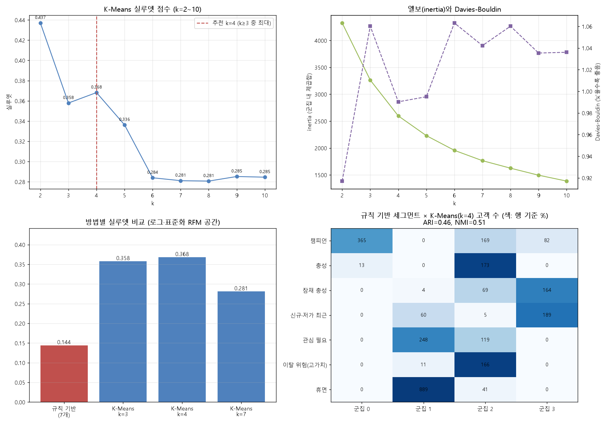

- 로그 변환·표준화한 R/F/M에 K-Means를 돌려 k=2–10의 실루엣을 비교했습니다. k=2가 가장 높지만(0.437) 너무 거칠어서, k=3 이상 중 최대인 **k=4(0.368)**를 선택했습니다.
- 규칙 기반(5분위 점수 → 7개 세그먼트)의 실루엣은 0.144입니다. 같은 7개로 비교하면 K-Means(0.281)가 높습니다. 두 방법의 일치도는 ARI 0.46으로 중간 수준입니다.
- 규칙 기반은 기준이 명확해 설명하기 쉽고, K-Means는 적은 그룹으로 같은 구분력을 냅니다.

| 군집 | 고객 수 | 금액 비중 | 주문당 평균 금액 |
|---|---|---|---|
| 핵심 우량 | 378 (13.7%) | 54.9% | 522.56 |
| 중간 활성 | 742 (26.8%) | 27.2% | 415.25 |
| 최근 소액 | 435 (15.7%) | 7.6% | 300.27 |
| 이탈 위험 | 1,212 (43.8%) | 10.4% | 244.15 |

군집 이름은 프로파일을 보고 붙인 것입니다.

**이탈 위험 군집의 주문 금액 분포**

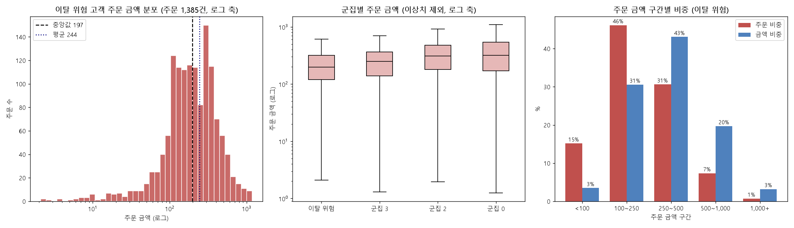

이탈 위험 고객(1,212명, 주문 1,385건)의 주문 금액 중앙값은 197, 평균은 244입니다. 주문의 61%가 250 미만이고 고객의 87%가 기간 내 구매 1회입니다. 큰 고객이 떠난 것이라기보다 소액으로 한 번 사고 재구매가 없는 고객이 많습니다.

**핵심 우량 군집 내부: 산포도와 분위 구간**

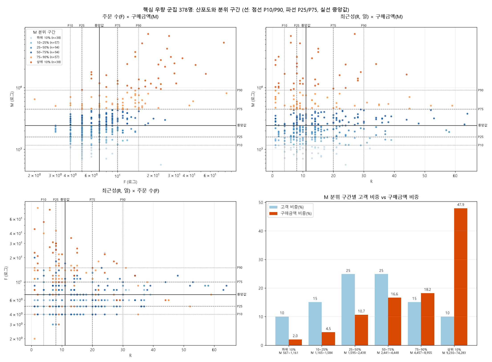

핵심 우량 378명 중 구매금액 상위 10%(38명)가 군집 금액의 47.9%를 차지합니다(중앙값 2,440, 평균 4,740). 군집 안에서 금액이 클수록 주문 횟수가 아니라 **한 번에 사는 금액**이 큽니다. 최근성은 금액과 거의 무관합니다.

### 4-2. 재구매율

기준일(2011-09-01) 이후 30/60/90일 안의 재구매율입니다. 그룹은 기준일 이전 정보로 만들고 이후 행동으로 평가했습니다.

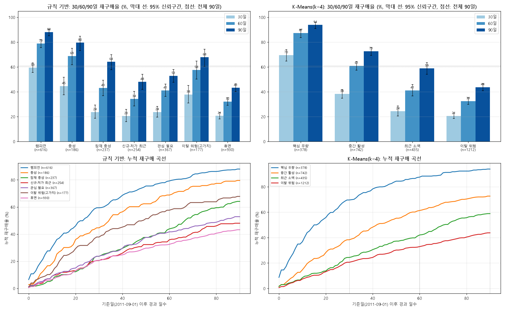

| 군집 (K-Means) | 30일 | 60일 | 90일 |
|---|---|---|---|
| 핵심 우량 | 69.6% | 87.3% | 93.9% |
| 중간 활성 | 38.3% | 60.9% | 72.6% |
| 최근 소액 | 24.4% | 41.2% | 58.8% |
| 이탈 위험 | 20.6% | 32.5% | 43.7% |

- 두 방법 모두 RFM이 높을수록 재구매율이 높고, 90일 재구매를 구분하는 힘(AUC)은 약 0.70으로 비슷합니다. K-Means는 4개 그룹으로 최고–최저 격차가 더 큽니다(50.2%p vs 44.8%p).
- 규칙 기반 "이탈 위험(고가치)" 세그먼트는 R이 길어도 90일 재구매율이 67.8%로, 휴면(43.2%)보다 높습니다. 과거에 많이 산 고객은 오래 쉬어도 돌아올 가능성이 높습니다.
- 기준일이 성수기(9–11월) 직전이라 평소보다 높게 나온 값입니다.

### 4-3. 코호트 유지율

고객의 첫 구매 월을 코호트로, 첫 구매 후 경과 개월마다 구매한 고객 비율을 봤습니다(2011-12는 부분 월이라 제외, 코호트 24개).

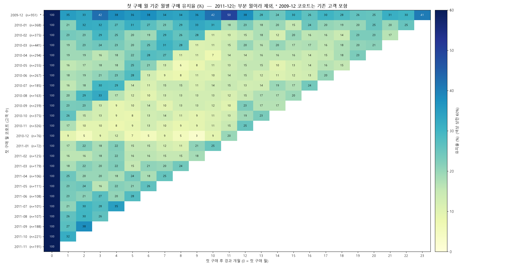

- 1개월 뒤 유지율은 평균 약 23%(2010-01 이후 코호트만 21%)이고, 6–12개월 뒤에도 비슷한 수준(18–23%)을 유지합니다. 한번 다시 온 고객은 계속 주기적으로 옵니다.
- 같은 달(대각선 방향)에 값이 올라가는 계절성이 뚜렷합니다. 가을 성수기에는 코호트와 관계없이 재구매가 늘어납니다.
- 2010-12 코호트가 가장 약합니다(76명, 다음 달 유지 9.2%). 연말 선물성 일회 구매가 많았을 가능성이 있습니다.
- 2009-12(데이터 시작 월)와 2010년 초 코호트는 기존 고객이 섞여 유지율이 높게 나옵니다. 진짜 신규는 2010-12 이후 코호트부터 봐야 합니다.

### 4-4. 판매 흐름: 주간·요일

**주간 판매 (월–일)**

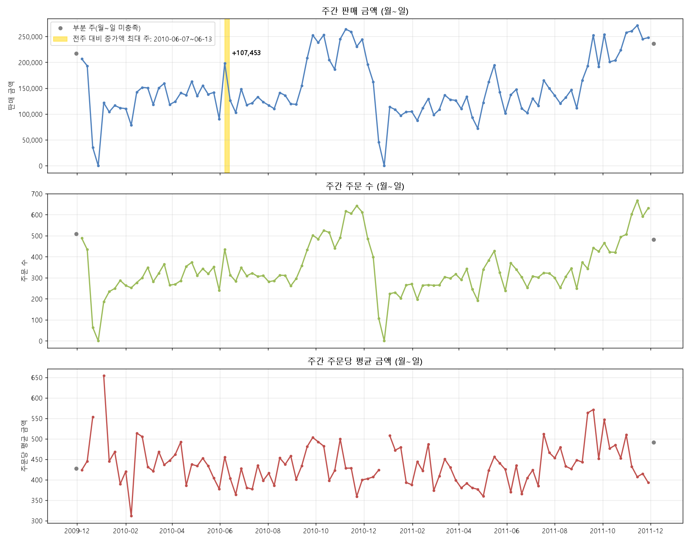

- 총 106주, 주간 판매 금액 평균 150,629(최대 271,433, 2011-11-14 주). 9–11월에 높고 연말 직전에 급락하며, 2009-12-28 주와 2010-12-27 주는 판매가 0입니다.
- 전주 대비 증가액이 가장 큰 주는 2010-06-07 주(+107,453)입니다. 직전 주(공휴일이 낀 주로 추정)가 낮았다가 반등한 영향이 큽니다.
- 데이터 시작·끝 주는 월–일이 채워지지 않아 증가액 비교에서 제외했습니다.

**요일별 판매**

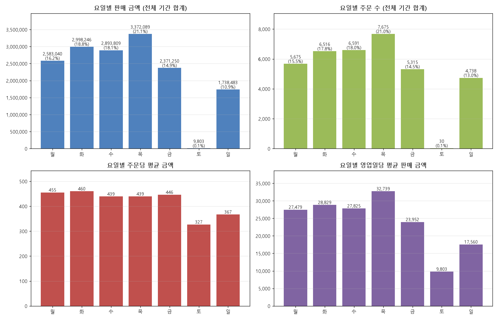

- 목요일이 판매 금액(21.1%)과 주문 수(21.0%) 모두 가장 큽니다. 일요일은 10.9%, 토요일은 판매일이 하루뿐이라 사실상 휴무입니다.
- 주문당 평균 금액은 화요일(460)이 가장 높고 일요일(367)이 가장 낮습니다.

**신규 고객의 요일별 첫 구매**

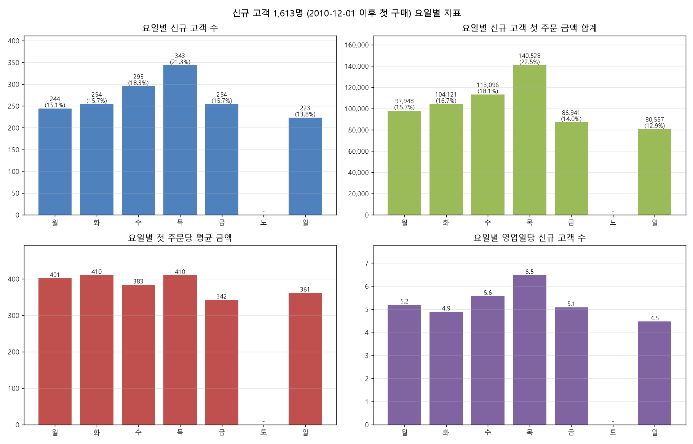

2010-12-01 이후 처음 구매한 신규 고객 1,613명 기준입니다(앞 12개월을 워밍업으로 두어 기존 고객이 신규로 잡히지 않게 했습니다). 목요일 유입이 가장 많고(343명, 21.3%), 일요일은 전체 주문 중 신규 첫 주문 비율이 가장 높습니다(10.3%).

**잠재 충성 고객(최근 소액 군집)의 요일별 지표**

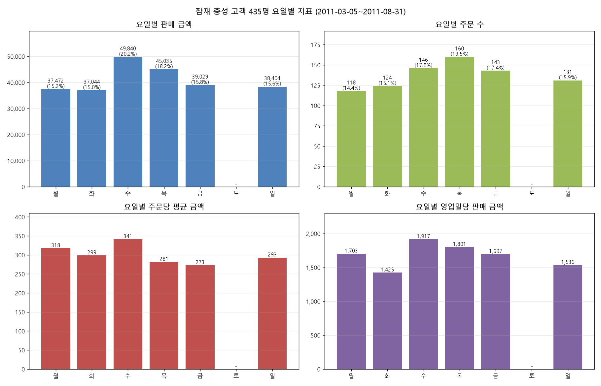

435명의 수요일 판매 금액이 가장 큽니다(49,840, 20.2%). 목요일은 주문 수가 가장 많지만 주문당 금액은 낮습니다.

### 4-5. 매출 증가 원인 분석 (KPI 트리)

**2011-09-19 주 전후 판매량**

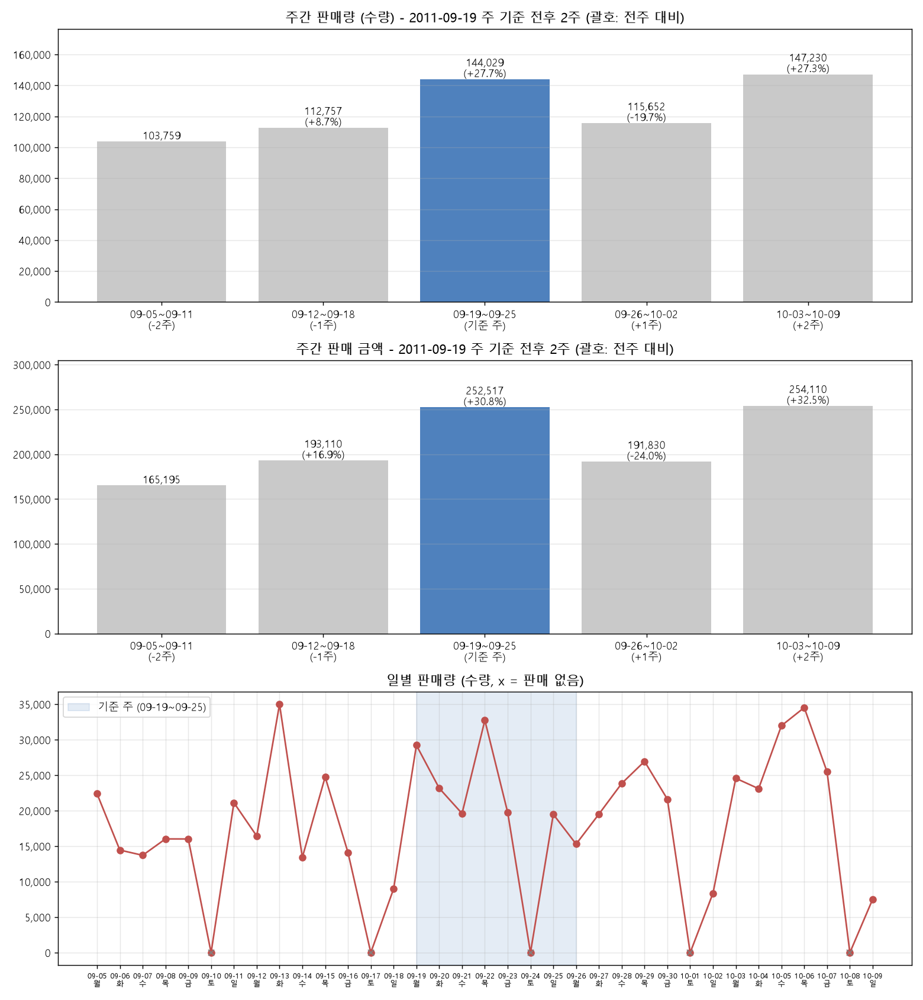

기준 주 판매량이 직전 주보다 27.7% 늘었다가 다음 주에 19.7% 줄어 원래 수준으로 돌아갔고, 그다음 주에 다시 올랐습니다(한 주만 튀는 모양).

**KPI 트리와 기여도**

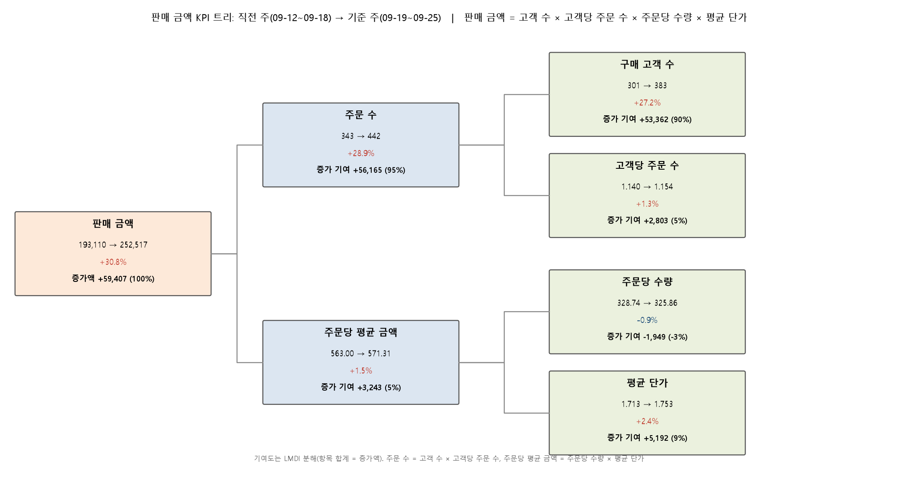

판매 금액 = 구매 고객 수 × 고객당 주문 수 × 주문당 수량 × 평균 단가로 분해하고, 기여도는 LMDI(로그평균 분해)로 계산해 항목 합이 증가액과 정확히 일치합니다. 직전 주 대비 증가액은 +59,407(+30.8%)입니다.

| 항목 | 기여 | 비중 |
|---|---|---|
| 구매 고객 수 (301 → 383) | +53,362 | 90% |
| 고객당 주문 수 | +2,803 | 5% |
| 주문당 수량 | -1,949 | -3% |
| 평균 단가 | +5,192 | 9% |

**드릴다운**

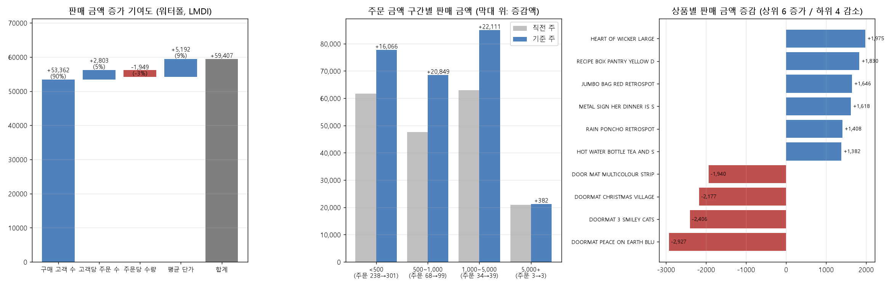

이상 주문 제외 후에는 특정 대형 주문의 영향이 없고, 증가의 대부분이 구매 고객 수 증가입니다. 주문 금액 구간별·상품별 증감도 한곳에 쏠리지 않고 분산돼 있습니다.

### 4-6. 고객 유형별 구매 구조

**주문 구성(상품 종류 수, 종류당 수량, 총 주문 금액) 기반 군집**

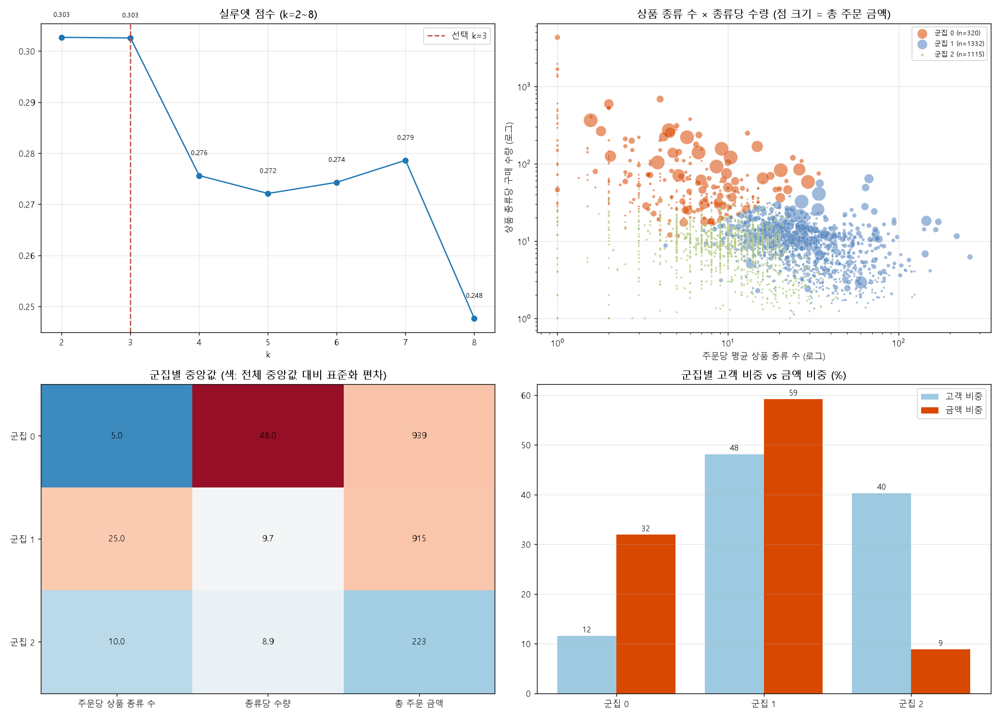

주문당 상품 종류 수, 상품 종류당 구매 수량, 총 주문 금액으로 K-Means(k=3, 실루엣 0.303)를 돌렸습니다.

| 군집 | 고객 수 (비중) | 주문당 상품 종류 | 종류당 수량 | 금액 비중 | 90일 재구매 |
|---|---|---|---|---|---|
| 소품종 대량형 | 320 (11.6%) | 5 | 48 | 31.9% | 61.6% |
| 다품종 구색형 | 1,332 (48.1%) | 25 | 9.7 | 59.2% | 71.6% |
| 소량·소액형 | 1,115 (40.3%) | 10 | 8.9 | 8.9% | 47.5% |

총 주문 금액이 비슷한 두 군집이 구매 방식에서는 정반대입니다(소수 품목 대량 vs 다품종 구색). 소량·소액형의 73%는 RFM 이탈 위험 군집입니다. 군집 구분 정도가 낮아(실루엣 0.303) 경향으로 읽어야 합니다.

**잠재 충성 고객의 상품 카테고리**

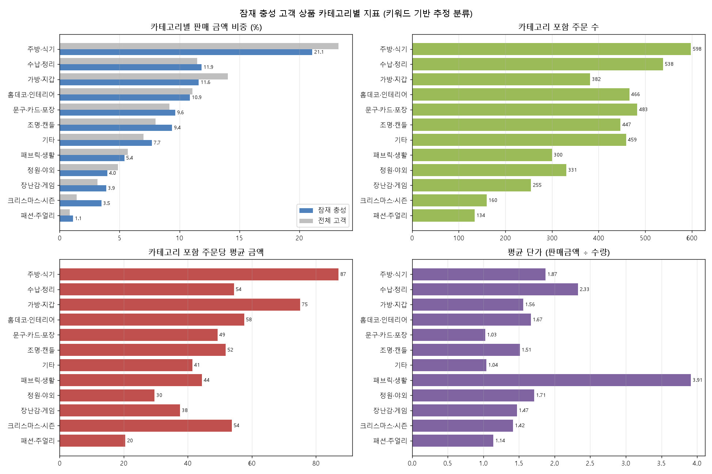

원본에 카테고리 열이 없어 **상품명 키워드로 추정한 분류**입니다. 주방·식기가 21.1%로 가장 크고 수납·정리(11.9%), 가방·지갑(11.6%)이 뒤를 잇습니다. 전체 고객 대비 크리스마스·시즌, 조명·캔들 비중이 높습니다.

### 4-7. 상품 판매 구조와 장바구니

**상품별 판매 금액 비중**

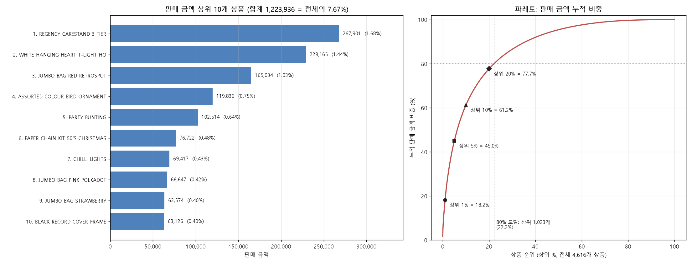

- 상품 4,616개 중 상위 10개의 합이 전체 판매 금액의 **7.67%**입니다(1위 REGENCY CAKESTAND 3 TIER 1.68%, 2위 WHITE HANGING HEART T-LIGHT HOLDER 1.44%).
- 상위 1%가 18.2%, 상위 20%가 77.7%를 차지하고 80%에 도달하려면 1,023개(22.2%) 상품이 필요합니다. 한두 개 히트 상품이 아닌 롱테일 구조입니다.
- 이름이 같은데 코드가 여러 개인 경우(37개 이름군, 81개 코드)는 판매의 0.48%이고 상위 10개 순위에는 영향이 없습니다(`19_suspected_duplicate_products.py`).

**함께 구매된 상품 쌍 (건수 기준)**

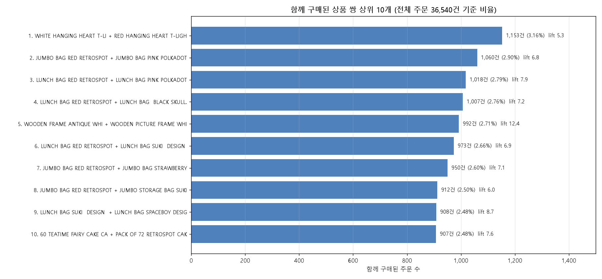

전체 주문 36,540건 중 같은 주문에 함께 담긴 상위 조합입니다. 1위 WHITE + RED HANGING HEART T-LIGHT HOLDER가 1,153건(3.16%)이고, 상위 10개 모두 같은 상품군의 색상·디자인 변형입니다.

**지지도 1% 이상 조합의 향상도**

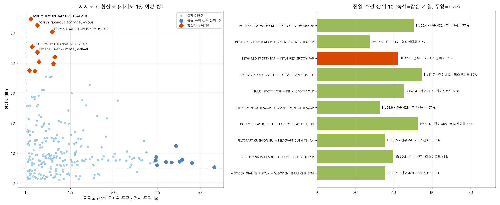

- 함께 산 주문이 전체의 1% 이상인 조합 255개로 향상도(lift)를 계산했습니다.
- **향상도 상위 10개와 건수 상위 10개는 하나도 겹치지 않습니다**(순위 상관 -0.11). 건수 상위는 인기 상품끼리(향상도 5–12), 향상도 상위는 세트형 상품(향상도 37–55)입니다.
- 일반 고객(대량 구매 고객 제외)만으로 다시 계산해도 255쌍 중 248쌍이 1% 이상을 유지해 추천은 대량 고객 때문이 아닙니다.

## CRM·진열 제안

**핵심 우량 군집 내부 CRM 타깃** (`17_core_crm_segments.py`, `outputs/tables/core_crm_segments.csv`)

| 타깃 | 규칙 | 고객 수 | 30일 / 90일 재구매 | 평소 구매 간격 | 전략 방향 |
|---|---|---|---|---|---|
| A 이탈 조짐 | R ≥ 30일 | 40 | 70.0% / 95.0% | 22일 | 평소 간격×1.5 경과 시 재입고·신상품 안내, 쿠폰은 마지막에 |
| B VIP | M 상위 10% | 36 | 86.1% / 97.2% | 10일 | 전담 관리, 사전 재고 확보, 선공개 |
| C 핵심 단골 | M 중앙값–상위 10% | 126 | 77.8% / 96.0% | 21일 | 간격의 70–80% 시점 리마인드, 주문 규모 확대 |
| D 성장 후보 | M 중앙값 미만 | 176 | 60.2% / 91.5% | 32.5일 | 간격 단축(25–28일), 묶음 구매 제안 |

핵심 우량의 90일 재구매율이 이미 94%라서 "재구매를 시키는 것"보다 **구매 간격 단축, 주문 규모 확대, 이탈 조짐 조기 포착**이 과제입니다. 쿠폰 금액·무료배송 기준 같은 값은 운영 정책에 따라 정해야 하는 가정입니다.

**진열 추천** (`basket_display_recommendations.csv`)

- 교차 진열(다른 종류 상품): 종이컵+종이접시+냅킨(RED SPOTTY 파티 식기, 향상도 14–42), 설탕 볼+우유 주전자(25.6), TOY TIDY+재활용 가방(19.9), 흰 목재 가구 코너(프레임+캐비닛, 8–18)
- 같은 계열 변형 인접 진열: REGENCY TEACUP AND SAUCER(향상도 27–33), 3 PIECE MINI DOTS CUTLERY SET(20–26), ALARM CLOCK BAKELIKE(20–22), KEY FOB(40–44), HAND WARMER(17–20)
- 큰 판매 규모의 인접 진열: HANGING HEART T-LIGHT HOLDER 흰색+빨강, JUMBO BAG, LUNCH BAG 계열

## 한계와 주의점

- **탐색적·기술적 분석입니다.** 인과 검증(실험, 통계 검정)과 개별 고객 예측 모델은 없습니다. CRM·진열 제안은 가설이며 A/B 테스트로 확인해야 합니다.
- 재구매율은 같은 고객 집합으로 그룹을 만들고 평가한 **표본 내 결과**이고, 기준일이 성수기 직전이라 평소보다 높게 나옵니다.
- 이상 주문(주문 금액 > 12,499)과 전액 취소 주문 54건은 통계 기준으로 제외했으며, 도매형 고객의 정상적인 대량 주문도 일부 빠졌습니다. 기준은 `01_build_analysis_dataset.py` 상수로 조정할 수 있습니다.
- 대량 구매 고객 판정(주문당 수량 중앙값 ≥ 400 또는 상품당 수량 중앙값 ≥ 24)은 분포에 뚜렷한 분리점이 없어 정한 가정값입니다. 일반 고객 데이터셋은 만들었지만 모든 분석을 그 기준으로 다시 돌리지는 않았습니다.
- 군집 이름("핵심 우량", "잠재 충성" 등)과 상품 카테고리(키워드 기반)는 해석을 위해 붙인 것으로, 데이터에 있는 정보가 아닙니다.
- 데이터는 2009–2011년 영국 소매업체 거래이며 오늘의 서비스에 그대로 일반화할 수 없습니다.
- 모든 금액은 원본의 통화 단위(파운드로 추정)이고, 환산하지 않았습니다.
